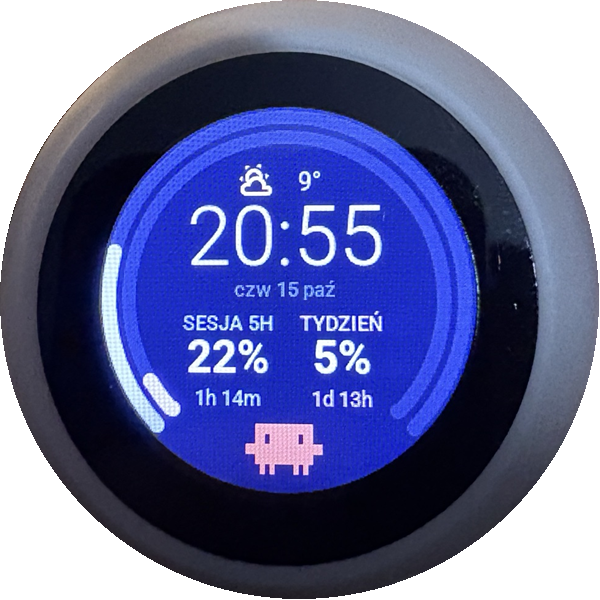
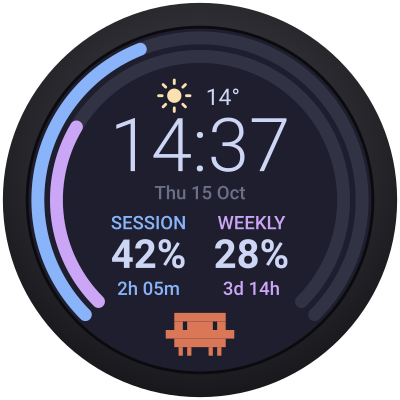

# Claude Usage Meter (ESP32-S3 round display)

ESPHome firmware that turns a **Spotpear "Xiaozhi AI Ball"** (ESP32-S3 with a 1.28" round GC9A01A screen) into a desk gauge for your **Claude usage limits**, with data coming from Home Assistant.

<p align="center">
  
  &nbsp;&nbsp;
  
</p>
<p align="center"><sub>Left: the real device (photo taken before the labels switched from Polish to English). Right: screen mockup.</sub></p>

- **Outer arc:** 5-hour session usage (blue).
- **Inner arc:** weekly usage (mauve).
- Arcs and percentages turn peach at ≥60% and red at ≥85%.
- Countdown to each limit reset.
- Clock, date, and current weather with temperature.
- A pixel-art Clawd in the gap at the bottom.
- **Sound alerts** through the built-in speaker:
  - one beep at 80%, a triple beep at 95%;
  - a short melody when the session limit renews;
  - quiet hours 23:00–07:00 and an on/off switch in HA.

On-screen text is in English; the two Home Assistant entity names ("Podświetlenie" = backlight, "Dźwięki alertów" = alert sounds) are Polish. Colors follow [Catppuccin Mocha](https://catppuccin.com/palette).

## Hardware

| Part | Details |
|---|---|
| Board | Spotpear Xiaozhi AI Ball **V2** ([AliExpress](https://www.aliexpress.com/item/1005008821384965.html)), the version without battery and touch |
| MCU | ESP32-S3 N16R8: 16 MB flash, 8 MB octal PSRAM |
| Display | GC9A01A 240x240 round, SPI: CLK 4, MOSI 2, CS 5, DC 47, RST 38, backlight GPIO42 (inverted) |
| Audio | ES8311 codec, I2C SDA 15 / SCL 14; I2S LRCLK 45 / BCLK 9 / MCLK 16 / DOUT 8; amp enable GPIO46 |

All pins are listed in `substitutions:` at the top of the YAML. The V1 board uses a different display pinout, noted in a comment there. Pin mapping is based on [RealDeco/xiaozhi-esphome](https://github.com/RealDeco/xiaozhi-esphome).

## Requirements

- Home Assistant with the **ESPHome** add-on (ESPHome ≥ 2025.5).
- The [hass-claude-usage](https://github.com/trickv/hass-claude-usage) integration. It provides these sensors:
  - `sensor.<prefix>_session_usage`
  - `sensor.<prefix>_week_usage`
  - `sensor.<prefix>_session_reset_time`
  - `sensor.<prefix>_weekly_reset_time`
- Any `weather.*` entity.

## Setup

1. Copy `claude-usage-meter.yaml` and `claude_meter.h` into `/config/esphome/` in Home Assistant.
2. Add the keys from [`secrets.yaml.example`](secrets.yaml.example) to `/config/esphome/secrets.yaml`.
3. Edit the `substitutions:` at the top of the YAML:
   - `claude_prefix`: your hass-claude-usage entity prefix, e.g. `claude_usage_<account>`.
   - `weather_entity`: your weather entity.
4. In the ESPHome dashboard, press **Install**. Use USB for the first flash; later updates go over the air.
5. Adopt the device in **Settings → Devices & services**.

From the CLI:

```bash
esphome run claude-usage-meter.yaml
```

## Sounds

| Event | Sound |
|---|---|
| Session or weekly usage crosses 80% | one short beep |
| Usage crosses 95% | triple beep |
| Session usage drops below 10% after an alert | renewal melody |

- Each threshold plays only once per limit window. The alert level is stored in flash, so a reboot does not replay alerts.
- Thresholds, quiet hours and melodies are constants in [`claude_meter.h`](claude_meter.h).

To play any RTTTL tune from Home Assistant (this ignores quiet hours and the switch):

```yaml
action: esphome.esp32_ball_play_rtttl
data:
  song_str: "test:d=8,o=5,b=160:c,e,g,c6"
```

## Files

| File | Purpose |
|---|---|
| `claude-usage-meter.yaml` | Main ESPHome config: hardware, HA sensors, LVGL layout, audio |
| `claude_meter.h` | C++ helpers: ISO 8601 parsing, countdowns, dates, colors, weather icons, alert logic |
| `secrets.yaml.example` | Template for the secrets the config expects |

## License

[MIT](LICENSE)
